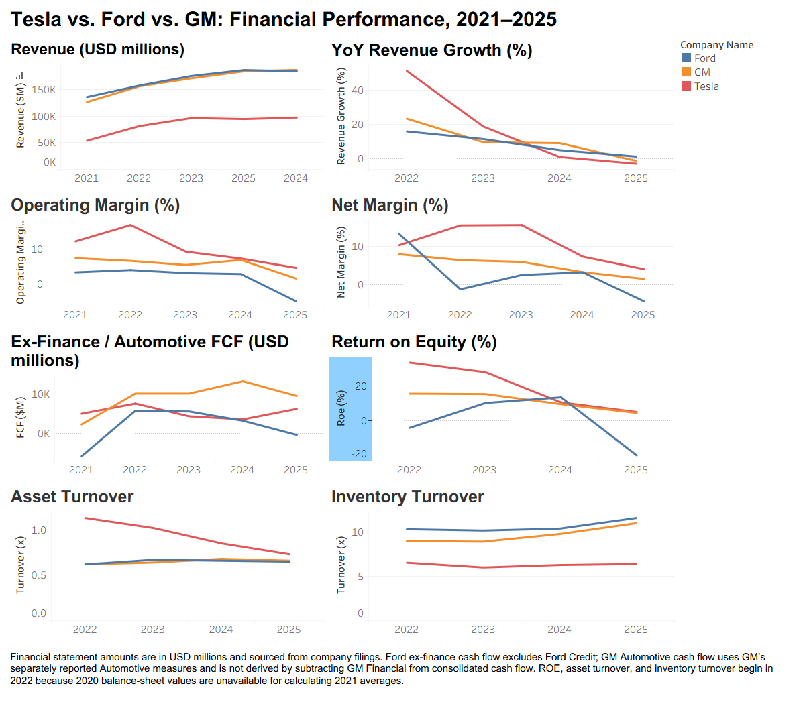

# Tesla vs. Ford vs. General Motors Financial Analysis

## Overview

This project compares the financial performance of Tesla, Ford, and General Motors from 2021 through 2025 using PostgreSQL and Tableau.

Annual financial statement data was organized into a relational database, analyzed with SQL, and visualized in an interactive Tableau dashboard.

The analysis focuses on revenue growth, profitability, cash generation, leverage, liquidity, and operating efficiency.

## Tools

- PostgreSQL
- SQL
- Tableau
- Visual Studio Code
- CSV financial statement data

## Business Questions

The analysis addresses the following questions:

- How has revenue growth changed across the three automakers?
- Which companies generated the strongest operating and net margins?
- How much free cash flow did each company generate?
- How does leverage change after separating financing-business debt?
- How efficiently are assets and inventory being used?
- How have return on equity and liquidity changed over time?

## Data Structure

The PostgreSQL database contains four primary tables:

### `companies`
Reference table containing company ID, ticker, and company name.

### `income_statements`
Annual income statement data including revenue, cost of revenue, gross profit, operating income, interest expense, and net income.

### `balance_sheets`
Annual balance sheet data including cash, inventory, assets, liabilities, shareholder equity, marketable securities, and finance versus non-finance debt.

### `cash_flows`
Annual cash flow data including consolidated operating cash flow and capital expenditures, along with separate ex-finance or automotive cash flow measures.

Financial statement amounts are reported in USD millions.

## SQL Workflow

The SQL analysis was developed in stages:

1. Created the relational database structure.
2. Loaded cleaned financial statement data.
3. Joined the financial statements into a unified company-year view.
4. Calculated core financial KPIs.
5. Used window functions to calculate year-over-year growth and average balance sheet values.
6. Created separate analytical views for Tableau.

### SQL Files

| File | Purpose |
|---|---|
| `01_create_tables.sql` | Creates the database tables and relationships. |
| `02_load_data.sql` | Loads the financial statement CSV files. |
| `03_create_base_view.sql` | Combines the financial statements into one analytical view. |
| `04_basic_kpis.sql` | Calculates profitability, cash flow, leverage, liquidity, and interest coverage metrics. |
| `05_revenue_growth.sql` | Calculates year-over-year revenue growth using `LAG()`. |
| `06_roe.sql` | Calculates return on equity using average shareholder equity. |
| `07_asset_turnover.sql` | Calculates asset turnover using average total assets. |
| `08_inventory_turnover.sql` | Calculates inventory turnover using average inventory. |

## Key Metrics

The analysis includes:

- Revenue growth
- Operating margin
- Net margin
- Free cash flow
- Ex-finance / automotive free cash flow
- Debt-to-equity
- Non-finance debt-to-equity
- Cash and marketable securities
- Interest coverage proxy
- Return on equity
- Asset turnover
- Inventory turnover

## Key Findings

- Tesla experienced rapid revenue growth early in the period, followed by slower growth and a revenue decline in 2025.
- Tesla maintained low non-finance leverage but experienced significant declines in operating margin, net margin, ROE, and asset turnover after 2022.
- Ford's consolidated debt-to-equity ratio was significantly affected by Ford Credit. Separating finance debt produced a more meaningful comparison with Tesla and GM.
- Ford reported strong consolidated free cash flow in 2025, while free cash flow excluding Ford Credit was slightly negative.
- GM maintained relatively moderate non-finance leverage and generated strong Automotive free cash flow during much of the period.
- GM's profitability declined substantially by 2025 despite relatively strong cash generation.
- Ford and GM showed higher inventory turnover than Tesla during the period.

## Accounting Comparability

Ford and General Motors operate large financing subsidiaries that materially affect consolidated debt and cash flow.

For this reason:

- Ford Credit debt is separated from Ford's non-finance debt.
- GM Financial debt is separated from GM's automotive debt.
- Ford ex-finance cash flow excludes Ford Credit.
- GM Automotive cash flow uses GM's separately reported Automotive measures.

GM Automotive operating cash flow and GM Financial operating cash flow are not assumed to sum to consolidated operating cash flow because intercompany cash flows are eliminated during consolidation.

The interest coverage metric is treated as a proxy rather than a fully standardized EBIT-to-interest ratio because financing operations reduce direct comparability across the three companies.

## Tableau Dashboard

The Tableau dashboard presents eight financial views:

- Revenue Trend
- Year-over-Year Revenue Growth
- Operating Margin
- Net Margin
- Ex-Finance / Automotive Free Cash Flow
- Return on Equity
- Asset Turnover
- Inventory Turnover



## Repository Structure

```text
automotive-financial-analysis/
│
├── data/
│   ├── income_statements.csv
│   ├── balance_sheets.csv
│   └── cash_flows.csv
│
├── sql/
│   ├── 01_create_tables.sql
│   ├── 02_load_data.sql
│   ├── 03_create_base_view.sql
│   ├── 04_basic_kpis.sql
│   ├── 05_revenue_growth.sql
│   ├── 06_roe.sql
│   ├── 07_asset_turnover.sql
│   └── 08_inventory_turnover.sql
│
├── tableau/
│   ├── automotive_financial_dashboard.twbx
│   └── dashboard.png
│
└── README.md